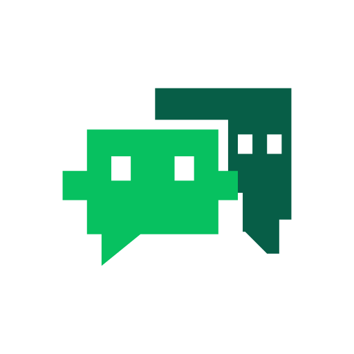

# WeSync

<p align="center"></p>

WeSync 是 macOS 上的本地微信记录浏览与 AI 上下文工具，基于 [GreenBubbles](https://github.com/bojieli/greenbubbles) 开发。当前私有开发仓库为 [wherexml/wesync](https://github.com/wherexml/wesync)，保留上游 Git 历史、MIT 许可与归属。

## 当前能力

- 原生聊天浏览：个人、群聊与其他分类，会话搜索、消息搜索、分页及阅读位置保持。
- 本地附件：图片、表情、引用、文件、PDF 与合并转发详情；附件恢复有明确校验边界。
- 本地加密缓存及可恢复备份；已读内容跨重启恢复。
- Agent 通过 `wechatsync-*` skills 读取允许的会话，整理带原消息引用的私人 Markdown 笔记。
- 会话级 AI 读取黑名单及不含消息正文的审计记录。

读取源文件时保持只读。使用云端 Agent 或内置 Gemini 摘要时，提供给模型的消息会发送至对应模型服务。参见 [隐私说明](PRIVACY.md)、[AI 黑名单](docs/AI_READ_BLACKLIST.md) 与 [已知限制](docs/KNOWN_LIMITATIONS.md)。

## 本机安装与升级

当前桌面应用为 `/Applications/WeSync.app`，运行于 Apple silicon、macOS 14 或更高版本。已有安装使用原来的稳定 Apple Development 身份进行本机更新；它与 Developer ID 公证分发是不同流程。

应用显示名称为 **WeSync**，底层命令继续使用 `greenbubbles`。Bundle ID、签名证书、连接凭据服务、缓存位置和工具标识保持兼容。旧的 `/Applications/GreenBubbles.app` 为指向 WeSync 的兼容软链接，使原有连接和命令继续可用。

更新必须先暂存签名候选包、核对原身份及工具摘要，再退出应用安装，最后通过原生入口冷启动并验证自动连接。具体步骤见 [本机签名](docs/LOCAL_SIGNING.md) 和 [WeSync 改名规范](docs/WESYNC_RENAME.md)。不要用上游 Homebrew 包覆盖这份本机安装。

本仓库保留上游发行基础设施。上游历史版本标注为 **Developer ID signed and Apple notarized**；该说明不表示当前私有 WeSync 已发布或公证。本次改名不发布标签、DMG 或 Homebrew 包。

## 从源码构建

需要 Swift 6、Xcode 命令行工具和 Rust：

```sh
git clone https://github.com/wherexml/wesync.git
cd wesync
cargo build --locked --release --manifest-path Native/GreenBubbles/Cargo.toml
swift build --product greenbubbles-history
swift run greenbubbles-history
```

源码模块和可执行文件保留兼容名称。源码运行不等于已安装 App 更新，不自动继承其签名与权限。

## CLI 与 Agent

已配置连接后，可继续使用现有命令：

```sh
greenbubbles chats
greenbubbles messages list --conversation "Alice"
greenbubbles messages search --conversation "Alice" --query "keyword"
greenbubbles source status
```

列表支持 cursor 分页与时间范围。消息内容、密钥、数据库、缓存和未经复核的原生截图不得提交到仓库。

Agent skills 保持 `wechatsync-setup`、`wechatsync-context`、`wechatsync-personal-memory` 名称。它们复用已有 CLI，不需要因品牌改名而重新获取数据库密钥。

## 文档

| 目的 | 文档 |
| --- | --- |
| 浏览与使用 | [用户指南](docs/USER_GUIDE.md) |
| 模块入口与完整索引 | [文档索引](docs/README.md) |
| CLI 命令 | [CLI reference](docs/CLI_REFERENCE.md) |
| Agent 接入 | [Agent skills](docs/AGENT_SKILLS.md) |
| 带引用的个人记忆 | [Personal memory](docs/PERSONAL_MEMORY.md) |
| 原生界面规范 | [Design system](docs/DESIGN_SYSTEM.md) |
| 仓库、上游与提交约定 | [Repository](docs/REPOSITORY.md) |
| 改名与免重复授权验收 | [WeSync rename](docs/WESYNC_RENAME.md) |

## 许可与归属

[MIT](LICENSE)。保留 GreenBubbles 及原作者归属，详见 [NOTICE.md](NOTICE.md) 与 [第三方声明](THIRD_PARTY_NOTICES.md)。WeSync 为独立项目，与腾讯无隶属或背书关系。
