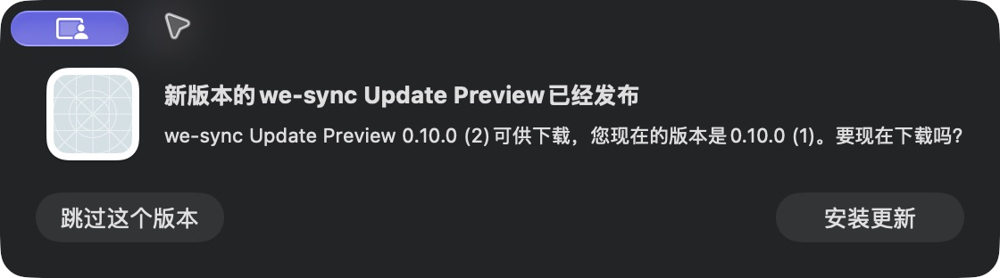

# GitHub 更新机制验收

2026-11-11，参考 CyberMe 的交互流程，使用 Sparkle 2.10.1 接入后台检查、签名验证、下载、确认安装与重启。[实现规范与重复步骤](../../GITHUB_UPDATES.md)。

| 验证 | 结果 |
| --- | --- |
| 原生升级 E2E | 13/13：无更新、篡改 feed/archive、暂缓、实际安装重启、同版、下载取消、数据保留 |
| 实际合成升级 | build 1 → 2 → 3；下载 build 4 时取消，保留 build 3 |
| 已公开 v0.10.1 DMG | Developer ID、公证票据、Gatekeeper、公开下载 SHA-256 及更新签名通过 |
| 临时篡改的真实 DMG 副本 | 发布预检拒绝，未生成 feed，原包未修改 |
| 最终本机安装 | 0.10.0（74），两次原生冷启动自动连接，无凭据输入 |
| 本机签名/工具 | 原身份、既有 CLI/输入 helper 字节保留，两次启动后主程序与候选摘要一致 |
| 原生入口 | 应用菜单和菜单栏均有检查更新；设置、关于、刷新正常 |
| 完整本机 CI | 最终 23/23；保留此前一次隔离 Rust SQLCipher 初始化失败与通过重跑记录 |

[原生 E2E 记录](native-e2e.json)、[安装记录](installed.json)、[发布包验证](initial-release.json)、[篡改预检](preflight.json)、[本机 CI](local-ci.json)。

**本机开发版与公开版是不同签名团队。** 当前安装继续保护原身份，检查入口可查看 GitHub 版本，不自动覆盖为公开团队。公开版从首次带 updater 的发行包开始支持完整应用内升级；旧 0.10.1 需要先手动安装该包一次。本轮没有发布新二进制版本，也没有开启 GitHub Actions。

初始更新源采用已有 v0.10.1 stable DMG：archive SHA-256 为 `735ff9e36f62b1d6ab07571a30a03c3017e3d334acfd556488dc8781dc26aff8`。签名 feed 与 archive 均由固定公钥验证，feed 失败不会超时降级。生产下载只接受本仓库 HTTPS Release DMG。安装仍需用户确认，不上报系统画像。

以下是独立原生合成应用的实际更新提示，不含真实聊天。另有[签名拒绝](rejected-archive.png)、[feed 拒绝](rejected-feed.png)、[升级后窗口](installed-preview.png)、[无更新](current.png)、[本机身份保护](local-channel.png)和[最终版本](about.png)。

合成 E2E 使用生产 HistoryUpdater 与 Sparkle，通道受 DEBUG + 独立 Bundle ID 约束。该流程早于最终菜单通知/启动顺序的小调整；最终源码另经真实安装两次冷启动与入口验证。首次取消因包过快未执行，后续慢速下载取消已通过；未模拟磁盘满、进程崩溃和启动失败的完整回滚。完整时间与失败边界保留在 JSON 中。
