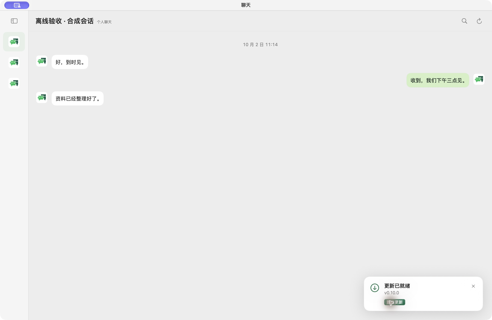

# 右下角自动更新与钥匙串验收

最终本机安装 **we-sync 0.10.0（75）**。参考 CyberMe V6，后台检查并自动下载，验证通过后在右下角显示紧凑卡片，点击“重启更新”。[实现和复验步骤](../../GITHUB_UPDATES.md)。

| 检查 | 结果 |
| --- | --- |
| 完整原生 E2E | 18/18，包含自动下载、关闭恢复、聊天滚动、实际重启、签名拒绝、重试与取消 |
| 实际升级 | 完整聊天应用 build 1 → 2，新版自动启动，合成数据保留 |
| 安装版 | build 75，两次原生冷启动自动连接、刷新、设置、关于和两个更新入口通过 |
| 凭据与权限 | 未输入密码；原签名/既有 helper 字节保留，无钥匙串 ACL/TCC 改动 |
| 封装复用 | 同证书 framework 字节完全相同，命中时 0 次 framework 重签，新主包签 1 次 |
| 破损复用 | 临时副本篡改后直接拒绝，没有静默重签 |
| 完整本机 CI | 最终 23/23，通过后提交；Actions 保持关闭 |

[原生记录](native-e2e.json)、[安装记录](installed.json)、[签名缓存](signing-cache.json)、[本机 CI](local-ci.json)。

用户看到的黑色空窗口是初期独立传输测试壳，被误留在前台；已退出并恢复真实聊天。默认 E2E 现在使用完整生产聊天组件与三条合成消息，浅色仅限该 DEBUG 预览进程，未改变用户系统主题。以下为实际运行的完整聊天界面和右下角就绪卡片，全部消息均为合成内容。

另有[下载进度](downloading-light.png)、[较早暗色结果](chat-ready-dark.png)、[签名错误原地提示](rejected-feed.png)、[安装版关于](about.png)。暗色记录来自较早调试包；后续最终浅色包覆盖取消、重试、实际重启，真实安装覆盖最终 release 主程序。

钥匙串提示的确切进程没有采集，不能倒推原弹窗根因。源码运行端不访问更新私钥或调用签名工具；制包端使用现有签名身份。实际客户端升级未输入密码，开发端新主包签名仍遵守 macOS 钥匙串授权。没有更改 ACL、partition list 或 TCC 来绕过授权。

现有本机 Apple Development 与公开 Developer ID 通道保持隔离，旧公开版首次启用 updater 仍需安装首个带机制的发行包。本轮没有发布新 DMG 或部署网站。磁盘满、进程崩溃及启动失败的全路径回滚未模拟，不能把验签失败保留旧包等同完整回滚覆盖。自动化曾遇到焦点变化和超时，重读窗口状态后完成最终两次启动，没有据此声称应用主线程被阻塞。
